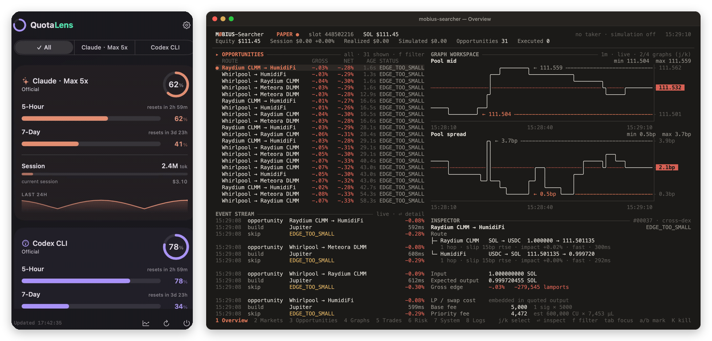
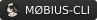

<!--
  You opened the hood. Good.
  Most people scroll. Builders inspect.
  — Marc / BUG / ø
-->

<table border="0">
<tr>
<td width="36%" align="center">

</td>
<td width="64%" valign="middle">

# Marc

**Founder & Builder** &nbsp;·&nbsp; 15 &nbsp;·&nbsp; Earth

I build agent systems, research tools, and products that try to make hard systems legible.

Call me **Marc**, **BUG**, or **ø**. Bad at small talk. Good at shipping.

Shh. The work is below.

</td>
</tr>
</table>

## Selected work

<table>
<tr>
<td width="50%" valign="top">

### <a href="https://github.com/mangiapanejohn-dev/QuotaLens">QuotaLens</a>

**Know your AI limits before they stop you.**

A native macOS menu-bar gauge for Claude and Codex quotas, accounts, tokens, cost, and history.

<code>brew install --cask mangiapanejohn-dev/tap/quotalens</code>

Swift · SwiftUI · local-first · macOS 13+

</td>
<td width="50%" valign="top">

### <a href="https://github.com/mangiapanejohn-dev/MOBIUS-Searcher">MØBIUS-Searcher</a>

**Real markets. Real transactions. Simulation first.**

A Rust + Ratatui Solana arbitrage research tool that prices executable routes, builds real v0 transactions, simulates them on mainnet, and records why apparent edge disappears.

So far: 3,091 evaluations, 2,333 mainnet simulations, [0 executable edges](https://github.com/mangiapanejohn-dev/MOBIUS-Searcher/blob/main/docs/PAPER_RUN.md). The zero is published too.

Rust · Solana · Jupiter · Ratatui · execution research

</td>
</tr>
<tr>
<td colspan="2" valign="top">

### <a href="https://github.com/maga2010org/hackathon-run">hackathon-run</a>

**Ship the demo, not the dream.**

A decision-making and execution system for hackathon teams under time pressure. Fifteen agent skills that cut scope, time-box the build, rehearse the demo, simulate the judges, and recover when the demo breaks on stage.

TypeScript · agent skills · npm &nbsp;·&nbsp; built with Stephen under <a href="https://github.com/maga2010org">Stephen&amp;Marc</a>

</td>
</tr>
</table>

 
QuotaLens in the menu bar &nbsp;·&nbsp; MØBIUS-Searcher in a live PAPER session

## Now building

Private for now. They ship here when they are ready.

<table>
<tr><th align="left">Project</th><th align="left">What it is</th><th align="left">Built with</th></tr>
<tr><td><b>Offmap-X</b></td><td>Site, applications, and event portal for a 72-hour offline builder event</td><td>Next.js · Supabase</td></tr>
<tr><td><b>Weekly growth reports</b></td><td>What a school's teachers use every week to write student evaluations</td><td>Next.js · Supabase · Turborepo</td></tr>
<tr><td> <b>MØBIUS</b></td><td>Not telling yet. See photo.</td><td>TypeScript · MCP</td></tr>
</table>

## The thesis

> The space between a human and an AI is the next platform.  
> Most people are still building it like a chat box.

I care about three things:

- agents with memory, personality, and presence;
- products with taste, not feature noise;
- communities where young builders ship instead of scroll.

## Working with

<table>
<tr><td><b>Languages</b></td><td>    </td></tr>
<tr><td><b>Apple</b></td><td>  </td></tr>
<tr><td><b>Web</b></td><td>     </td></tr>
<tr><td><b>Data & infra</b></td><td>     </td></tr>
<tr><td><b>Systems & markets</b></td><td>  </td></tr>
<tr><td><b>Agents</b></td><td>  </td></tr>
<tr><td><b>Tests</b></td><td> </td></tr>
</table>

<b>FAQ nobody asked for</b>

 

**Why is everything else private?**  
It is not ready. When it is, it ships here first.

**Marc, BUG, or ø?**  
Any of them. BUG is a nickname, not a status report.

**Can we build something together?**  
[Email me](mailto:mangiapanejohn@gmail.com). Skip the small talk.

 

   
  <b>ø</b> &nbsp;·&nbsp; Building my future company one commit at a time. &nbsp;·&nbsp; <a href="https://marcyy.me">marcyy.me</a>
   
  Made it this far? That is builder behavior. <a href="mailto:mangiapanejohn@gmail.com">Say hi.</a>

